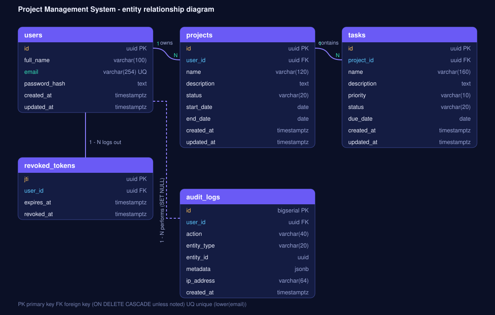
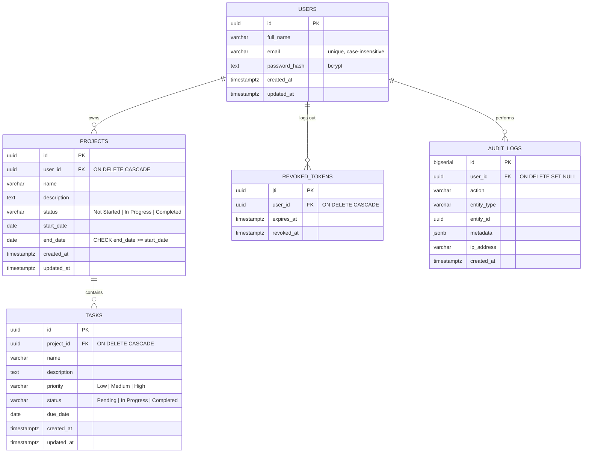

# Database design

PostgreSQL 13+. The schema lives in [`backend/src/db/migrations/001_init.sql`](../backend/src/db/migrations/001_init.sql) and is applied automatically on boot (`AUTO_MIGRATE`) or with `npm run migrate`.

## Design decisions

| Decision | Why |
|---|---|
| **Third normal form**, one table per entity | No repeated data; a project's task counts and progress are computed, never stored, so they cannot drift. |
| **UUID primary keys** (`gen_random_uuid()`) | IDs in URLs are not guessable or enumerable. |
| **Foreign keys with `ON DELETE CASCADE`** (users → projects → tasks) | Deleting a project removes its tasks and deleting a user removes everything they own, without orphans. Audit rows use `SET NULL` so history survives. |
| **Ownership through the parent** | Tasks have no `user_id`; they belong to a project, and every task query joins to `projects.user_id`. One source of truth, and a user can never reach another user's tasks. |
| **`CHECK` constraints** on status, priority, dates and non-blank names | The database enforces the rules even if a bug bypasses the API validation. |
| **Unique index on `lower(email)`** | `Ada@x.com` and `ada@x.com` are the same account. |
| **`DATE` for start/end/due dates**, `TIMESTAMPTZ` for audit fields | Calendar days carry no timezone; instants always do. |
| **Indexes** on `(user_id, created_at)`, `(user_id, status)`, `tasks(project_id)`, `tasks(project_id, status)` | Cover the list, filter and dashboard queries. |
| **`updated_at` trigger** | Maintained by the database, not by application code. |
| **`revoked_tokens` keyed by JWT `jti`** | Logout really invalidates a token, not just on the client. Expired rows are purged opportunistically. |
| **`audit_logs` with `JSONB` metadata** | Append-only history of create/update/delete/login events. |
